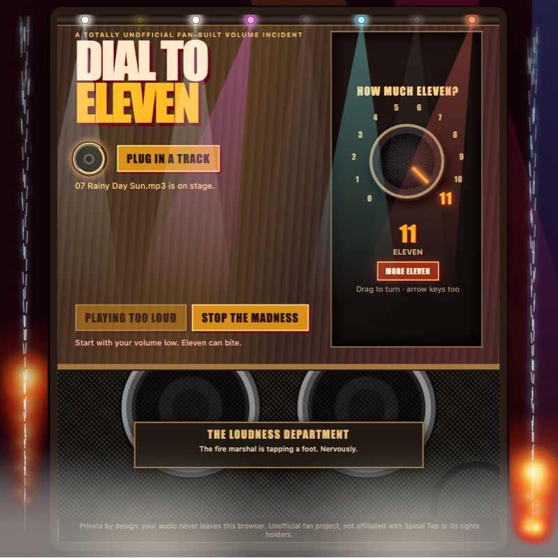

# Dial to Eleven

> **A browser-based loudness incident for people who know ten is merely where the other knobs stop.**

Load an audio file by clicking the jack or the button, then click a number or turn the rotary dial by dragging/arrow keys. Your last dial stop is remembered (a first visit starts at 3); zero is genuinely silent. **Eleven is deliberately a cliff beyond ten**: more gain, compression, saturation, and high-mid bite. Only at eleven does the Loudness Department start issuing new warnings every eight seconds. While a track actually plays, the stage lights run on independent cues and fog builds in from both sides of the amp in proportion to the dial; stopping fades the fog and cuts the lights. Playing at eleven also launches simulated rising fireballs and tall cold sparks that crest and fall, while the amp, lettering, speaker cones, and clickable jack react to audio samples. **More eleven**, available only at eleven, persists across reloads and adds another jump in distortion, a bounded rhythmic grind, stronger shaking, and a denser spark shower. Reduced-motion settings stop the theatrical motion while preserving the audio controls. Everything stays in your browser; your riffs never travel to a server in a tiny black van.



*Eleven during playback of a locally selected track. The flames and sparks are pixels, not a venue permit.*

## Why this exists

I went to the last day of a library's annual book sale fundraiser: name-your-price day. CDs normally sold for 50 cents. I spotted *Spinal Tap: Break Like the Wind* with an old Ear Candy markdown sticker still on it, priced at $6.99. I'd watched the movie decades ago and recognized the group immediately. My father was clueless.

I took the CD home and listened. It wasn't what I expected. It needed to make some noise, but nothing in the house had a dial that went past ten. So I built one.

## What the knob does

| Dial | Officially irresponsible technical behavior |
| --- | --- |
| 0 | Nothing. Actual silence. The drummer can have a moment. |
| 1–5 | More gain, more density, a little edge around the moustache. |
| 6–10 | Compression starts leaning on the doorbell and distortion answers it. |
| 11 | A huge jump in preamp gain and saturation, extra compression, and audio-driven shaking. The optional **More eleven** button adds rougher saturation and a 14 Hz volume chop; it does not raise the master above its bounded range. |

It is not a magic way to make speakers exceed their physical limit. It is a deliberately aggressive *perceived loudness* effect, which means dynamic range gets squeezed and the waveform gets rougher. That is the point. Mostly.

## Run it

This is an intentionally dependency-free static site.

```bash
python3 -m http.server 8000
```

Then open `http://localhost:8000` and load an audio file. Or open `index.html` directly in a modern browser if it permits local module loading.

## Safety, because the road crew asked

- Start with your hardware volume low.
- The effect can produce abrupt, dense output—particularly at **11**.
- Try not to discover feedback at a volume that involves insurance paperwork.

## Legal-ish amplification

This is an unofficial fan project and is not affiliated with, endorsed by, or approved by Spinal Tap, its creators, or their rights holders. The code is MIT-licensed; see [LICENSE](LICENSE). The joke is free. The hearing damage is not.
